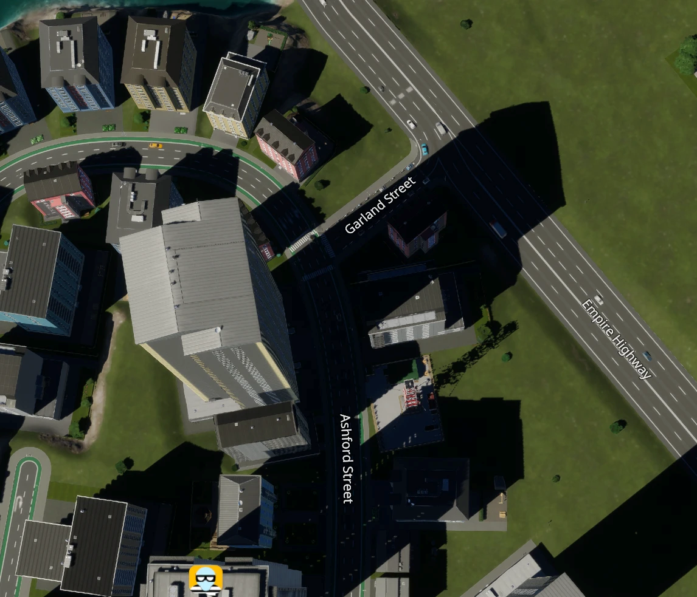
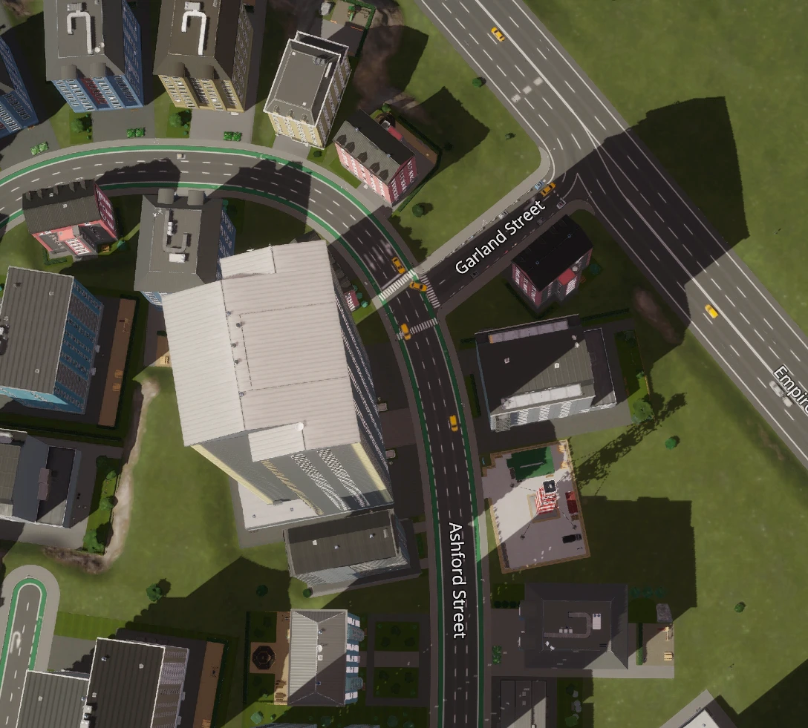
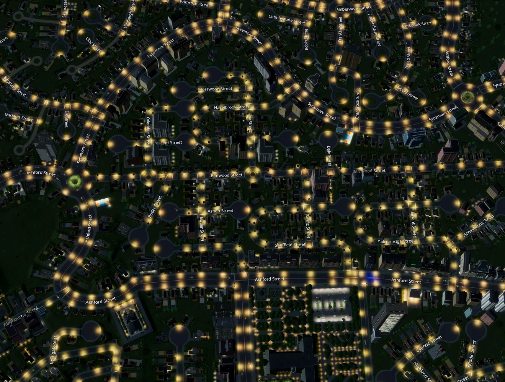
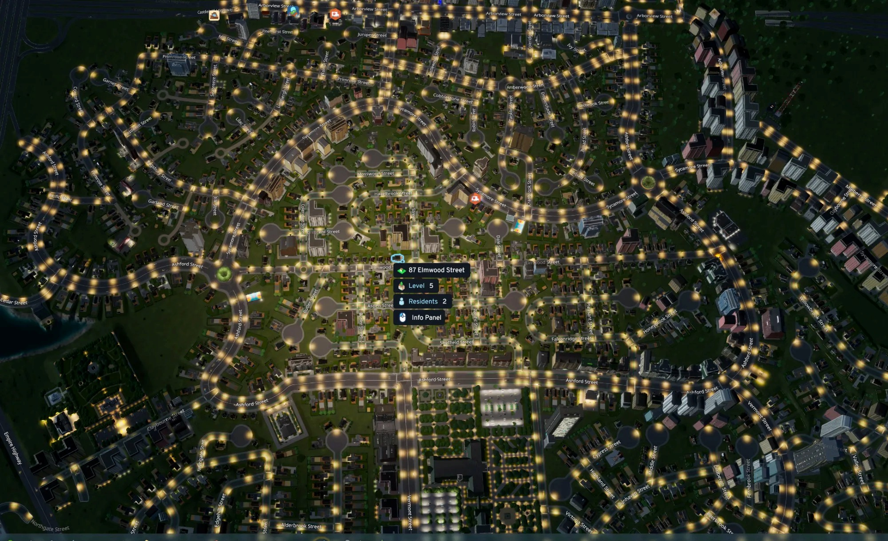
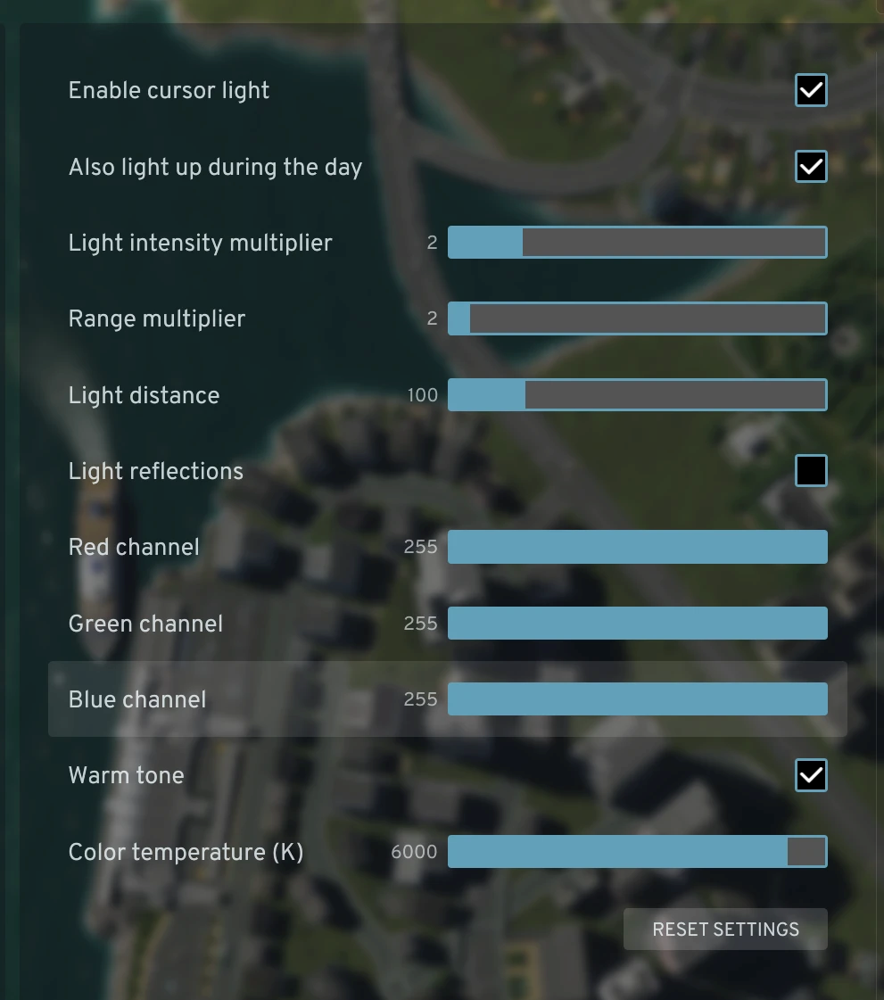

# Better Cursor Light

A Cities: Skylines II mod that puts a soft, adjustable light wherever your mouse points, so you can see what you are building at night and in the deep shadows of buildings during the day.

**Get it on Paradox Mods: [Better Cursor Light](https://mods.paradoxplaza.com/mods/168458/Windows)**, or search "Better Cursor Light" in the in-game Paradox Mods browser.

> **Based on [Mouse Light](https://github.com/Dnikolas991/MouseLight) by [Dnikolas991](https://github.com/Dnikolas991).** This project is a fork that extends the original with daytime lighting, softer light, warm tones and more settings. All credit for the original idea and the cursor light system goes to them.

| Without the light | With the light |
|---|---|
|  |  |
|  |  |

## Features

- **Day and night**: the light also works in daylight, so places hidden in building shadows are easy to see. Brightness is balanced automatically, so one intensity setting looks about the same by day and by night, with a smooth blend at dusk and dawn.
- **Light distance**: moves the light further back from the cursor, toward the camera, so it spreads over a wider area and looks softer.
- **Warm tone**: tints the light with a real color temperature, from 1500 K (candle) to 6500 K (daylight white).
- **RGB color** on the standard 0–255 scale.
- **Light reflections** toggle: turn off the shiny highlights the light makes on roads, water and glass for a matte look.
- **Intensity down to 0.1** for a subtle light.
- Settings text in English, Chinese (Simplified) and German.

## Settings

Open **Options → Better Cursor Light**.



| Setting | Range | Default |
|---|---|---|
| Enable cursor light | on / off | on |
| Also light up during the day | on / off | on |
| Light intensity multiplier | 0.1 – 10 | 3 |
| Range multiplier | 1 – 20 | 2 |
| Light distance (m) | 0 – 500 | 50 |
| Light reflections | on / off | off |
| Red / Green / Blue | 0 – 255 | 255 |
| Warm tone | on / off | on |
| Color temperature (K) | 1500 – 6500 | 6000 |

**Reset settings** restores all of these defaults.

## Building from source

Requirements:

- Cities: Skylines II with the **Mod Development Toolchain** installed (in game: Options → Modding).
- .NET SDK (installed by the toolchain) and the .NET 6 runtime (used by the toolchain's post-processor).

Build (close the game first):

```powershell
.\tools\build.ps1
```

The build copies the mod into your local Mods folder (`%USERPROFILE%\AppData\LocalLow\Colossal Order\Cities Skylines II\Mods\BetterCursorLight`), and the game loads it on the next start. The script refuses to run while the game is open, because the game locks the mod files.

## Contributing

Pull requests are welcome. See **[CONTRIBUTING.md](CONTRIBUTING.md)** for setup (including the toolchain's Unity license step), testing and code guidelines. Every push and PR runs `tools/check.ps1` in GitHub Actions. It can't compile the mod, because that needs the game, so the maintainer builds and tests PRs in game before merging.

## Publishing (maintainer)

Publishing settings are in `BetterCursorLight/Properties/PublishConfiguration.xml` (ModId 168458). Paradox Mods rejects any thumbnail or screenshot over 2.1 MB, so save large screenshots as JPG.

1. Bump `ModVersion`, write a `ChangeLog`, and commit.
2. Close the game and run `.\tools\publish.ps1`. It checks images and versions, uploads to Paradox Mods, then tags `vX.Y.Z`. Pushing that tag makes GitHub Actions create the GitHub Release.

To update only the description or images: `.\tools\publish.ps1 -PublishProfile UpdatePublishedConfiguration`.

### Thumbnail

`BetterCursorLight/Properties/Thumbnail.png` is generated from a screenshot by `tools/make-thumbnail.ps1` (Windows, uses WPF):

```powershell
powershell.exe -STA -File tools\make-thumbnail.ps1 -Source BetterCursorLight\Properties\Screenshots\4-night-without-light.jpg -Out BetterCursorLight\Properties\Thumbnail.png
```

## How it works

- `CursorGlowSystem` runs every frame. It raycasts from the mouse into the world (terrain, objects and networks) and works out how bright the light should be.
- `ExposureProbe` reads the camera's live HDRP exposure (asynchronously, from the GPU). The light's brightness is scaled against it with a curve fitted to in-game measurements, so it looks consistent at noon, at dusk, at night, in any weather and at any zoom. If the exposure can't be read (for example after a game update), it falls back to an estimate based on the time of day.
- `CursorLightController` keeps a single HDRP spotlight. It places the light back along the camera ray from the hit point, scales its size and brightness with camera distance, and smooths its movement.
- `CursorLightSettings` and `CursorLightLocale` hold the options and their texts.

## Credits

- **Original mod:** [Mouse Light](https://github.com/Dnikolas991/MouseLight) by [Dnikolas991](https://github.com/Dnikolas991). Better Cursor Light keeps its core design: an independent mouse raycast, a single smoothed HDRP spotlight, and camera-distance scaling.
- Mouse Light was itself inspired by the Cities: Skylines 1 mod EYM.

### Changes from Mouse Light

- Daytime lighting, with brightness that follows the camera's live exposure so it stays consistent day and night
- Light distance setting for a softer, wider light
- Warm tone (color temperature) setting
- RGB on a 0–255 scale
- Light reflections toggle
- Intensity down to 0.1
- New defaults, and renamed so it can be installed alongside the original
